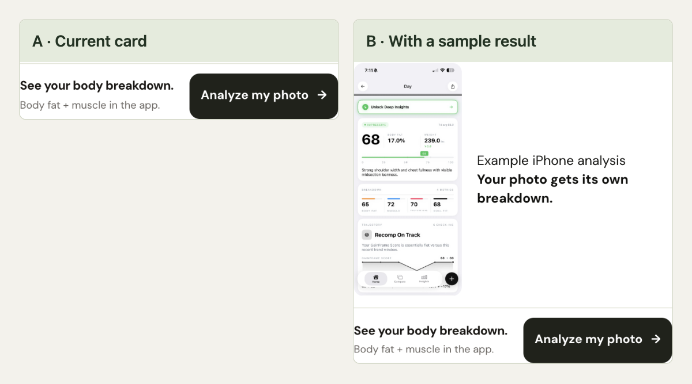

# November 16 release and search diagnosis

**Status:** Both conversion tests and the Thanksgiving guide update shipped in `923e7603`; the January article and printable shipped early by explicit request in `e954001d`. Workers Builds reported success at November 16 9:07:47 p.m. and 9:11:24 p.m. Eastern respectively. These are build completion timestamps. [Fitness Wrapped draft PR 45](https://github.com/mjrode/gain-frame-privacy/pull/45) contains the complete article, two inbound links and four assets. The developer’s live page says the 2026 wrap opens December 1. Check the real iPhone entry point, entitlement and date before merge.

## The two Body Visualizer options



A keeps the existing analysis invitation; B adds a labeled example of the real iPhone check-in result. Both use the same text, button and analysis Store listing. Randomize 50/50 after the first weight-slider adjustment on iOS; saved visitor assignment, phase `visualizer_result_example/v1`. The B layout takes more vertical space. Evaluate download clicks within 24 hours of assignment and exact-key native arrivals separately; inspect materially visible cards and page responsiveness. The earlier 13% is a **landing-session** baseline; size the test from eligible slider users. Use 14 full days and a prespecified sample based on that baseline, with at least 24 hours of outcome maturity. The overall landing/result rate is a traffic guardrail; assignment after a slider adjustment cannot measure a causal change in the first result that preceded assignment.

The men’s waist test assigns at article entry, 50/50, phase `waist_next_step/v1`. Control opens the existing estimator and the treatment offers a two-date tape/photo example and the comparison tool. Primary is a later personal result from the assigned destination, joined to that reader/session. Count subsequent Store reach separately; exclude demos and forced QA in both tests. Use the `paired_cta_assigned` event, verify unique-visitor and session arm integrity, and analyze first assignment, not raw events. A deterministic preview is available with the experiment ID as query parameter and `control` or `treatment` as its value.

## Search history

Final worldwide web search, Sunday–Saturday, sc-domain:gainframe.app. Each cell is Google clicks. The roundup cohort uses the same `/blog/best-` definition as the earlier conversion analysis. Other editorial lists and comparisons are outside this reproducible cohort.

| Week starting | All best lists | All blog | Body Visualizer | Photo estimator | Scanning & measurement apps | Body-fat scanner apps | Transformation apps | AI body-fat apps |
|---|---:|---:|---:|---:|---:|---:|---:|---:|
| 2026-07-26 | 469 | 1,074 | 0 | 388 | 98 | 30 | 62 | 138 |
| 2026-08-02 | 495 | 1,232 | 9 | 364 | 122 | 34 | 66 | 109 |
| 2026-08-09 | 515 | 1,574 | 68 | 418 | 147 | 37 | 54 | 116 |
| 2026-08-16 | 563 | 2,144 | 456 | 792 | 178 | 40 | 74 | 106 |
| 2026-08-23 | 599 | 2,700 | 696 | 596 | 153 | 52 | 69 | 133 |
| 2026-08-30 | 620 | 3,281 | 800 | 517 | 175 | 55 | 84 | 115 |
| 2026-09-06 | 644 | 3,646 | 2,254 | 772 | 198 | 44 | 69 | 109 |
| 2026-09-13 | 613 | 3,742 | 3,914 | 759 | 173 | 43 | 95 | 92 |
| 2026-09-20 | 598 | 3,847 | 4,945 | 1,043 | 177 | 62 | 72 | 83 |
| 2026-09-27 | 439 | 3,736 | 5,698 | 1,125 | 145 | 30 | 38 | 41 |
| 2026-10-04 | 448 | 3,811 | 6,651 | 765 | 151 | 28 | 38 | 31 |
| 2026-10-11 | 450 | 4,038 | 6,325 | 935 | 142 | 32 | 31 | 27 |
| 2026-10-18 | 331 | 3,954 | 7,654 | 905 | 69 | 3 | 26 | 22 |
| 2026-10-25 | 323 | 4,265 | 9,151 | 913 | 69 | 10 | 20 | 18 |
| 2026-11-01 | 289 | 4,007 | 10,410 | 1,031 | 54 | 4 | 6 | 12 |
| 2026-11-08 | 253 | 3,896 | 13,121 | 1,007 | 34 | 3 | 5 | 17 |

**Visualizer.** August 6 launch; August 26 title and copy changed to explicitly spell out height and weight, male/female references and input units, and three relevant articles added contextual links. The reference atlas also expanded. September 15 added 120 visual references and simplified the interface. Traffic was already rising before the October 6 and 29 CTA changes. The latter are candidates for conversion impact; pre/post traffic alone cannot isolate any single change. The height/weight query earned 334 → 1,141 clicks and moved 4.1 → 2.6. Across the whole page, impressions grew 71% with almost unchanged CTR and average position. The strongest transferable hypothesis is to name an input and an output readers already search for, let them try the tool immediately, and link it from pages where that task naturally follows. Test an explicitly labeled example on physique rating or the photo estimator and keep demo results separate from personal activation. Treat these additional tool changes as ideas, outside this release.

**Estimator.** Prior → latest 28 days: 3,868 → 3,856 clicks (−0.3%); 22,121 → 26,041 impressions (+17.7%); CTR 17.49% → 14.81%; position 4.11 → 4.55. Late-September rolling seven-day peak 1,162, latest week 1,007 (−13.3%), versus 765 in the October 4 week. Three high-intent exact terms lost 151 clicks: AI body fat estimator 109 → 54 (443 → 229 impressions, position 2.9 → 2.7); AI body fat calculator 139 → 90 (365 → 213 impressions, position 1.7 → 1.8); body fat estimator AI 107 → 60 (437 → 202 impressions, position 2.9 → 2.6). Other phrases offset some losses. Those three terms had fewer opportunities to earn a click; the site’s total exposure broadened at lower yield. The October 15 framing guide and November 9 Android read repair both affect the post-click experience. Search-referred landing → Store improved from 110/3,296 to 175/3,232. A November 16 US mobile snapshot for “ai body fat estimator” placed BiteKit first and GainFrame second organically and included an AI Overview and app result. It cannot reconstruct September's result layout.

**Roundups.** Latest 28 days against prior: 1,196 versus 1,935 clicks (−739, −38.2%); among 49 observed URLs, 23 declined, 10 rose and 16 were flat. The four named app lists lost 756 clicks combined, exceeding the net loss. Scanning/measurement 615 → 226 (−63%); body-fat scanners 152 → 20 (−87%); transformation apps 179 → 57 (−68%); AI body-fat apps 182 → 69 (−62%). Counterexamples include Apple Health scales 143 → 172, body-composition scales 121 → 145 and free body-fat apps 43 → 80. Blog overall gained 690 clicks.

Late September saw three app roundups lose ground together. The larger scanning and measurement guide held near 142–151 weekly clicks through October 17 before falling to 69. It added a disclosed, sponsored #2 entry October 10 and revised its copy October 10–12. Links are marked sponsored. The October 15 rewrite of the AI and scanner lists is another confounder, and postdates their initial loss. No causal conclusion about sponsorship or a specific release follows. In the November 16 US mobile snapshot for “ai body scanner app,” GainFrame’s scanning roundup was the first organic listing with an app result, AI Overview and People Also Ask before it. Its click decline can coexist with first place in one market and query. Historical feature coverage would be needed to measure whether these features expanded.

Google confirmed the [September 24 spam update](https://status.search.google.com/products/rGHU1u87FJnkP6W2GwMi/history) and the [November 10 broad core update](https://status.search.google.com/incidents/WLxcJyC6jMWMfryxsKMc). The first overlaps the first wave; the second started after both major declines. Matched Tuesday–Saturday windows yielded 193 roundup clicks November 3–7 versus 173 November 10–14. November could have contributed at the margin. Public documentation does not establish a roundup-specific devaluation. For the next editorial test, compare the same photo workflow on actual apps, document outcomes, limits and provenance, then re-read fixed owner/query/device cohorts after the rollout settles. [Google review guidance](https://developers.google.com/search/docs/specialty/ecommerce/write-high-quality-reviews)

## Release and indexing

The release build and all 227 tool tests passed. At iPhone size, both Visualizer layouts rendered after changing the slider, and both waist variants led to their intended destinations. The article keyword, two contextual inbound links, one-page 31-date PDF, published sitemap and public PDF checksum were verified. Both seasonal guides and their source posts passed strict inventory and production compilation. The GIF and contact sheet were exported from the actual timelapse tool’s illustrated sample; the app example in the draft is credited to the developer.

The Thanksgiving example appears in the existing weight-fluctuation guide. Google URL inspection immediately after the January release showed 88 indexed URLs and one unknown, the new calendar. The sitemap and both inbound links are live. The December 2026 search window and January usage should be measured separately. The first full 28-day calendar window ends December 14; read settled data around December 17. Track the calendar's target query, tool use, real photo results and attributable Store reach. The PDF currently has no dedicated completion event.

IndexNow accepted at Yandex, Seznam and Naver; Bing and the shared aggregator returned 403 site authorization. Manual Google URL inspection list:

```text
https://gainframe.app/blog/january-fitness-challenge/
https://gainframe.app/blog/why-does-my-weight-fluctuate/
https://gainframe.app/blog/winter-arc-challenge/
https://gainframe.app/blog/75-hard-vs-75-soft/
```
